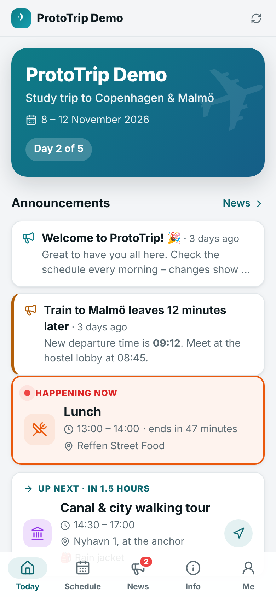
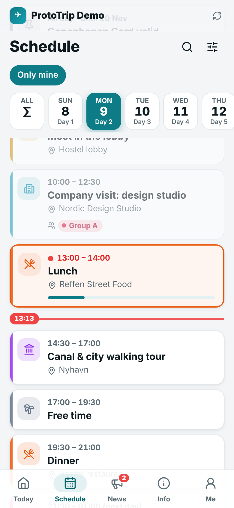
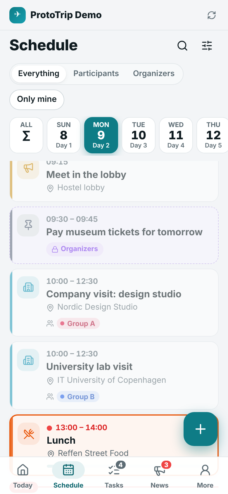
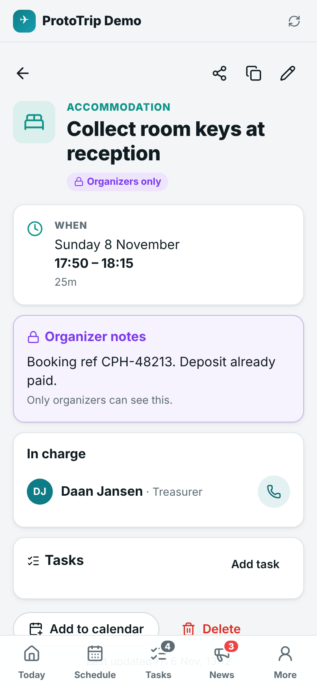
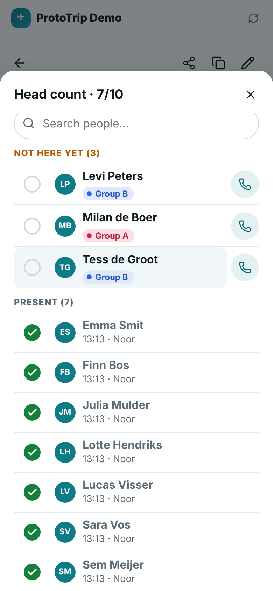
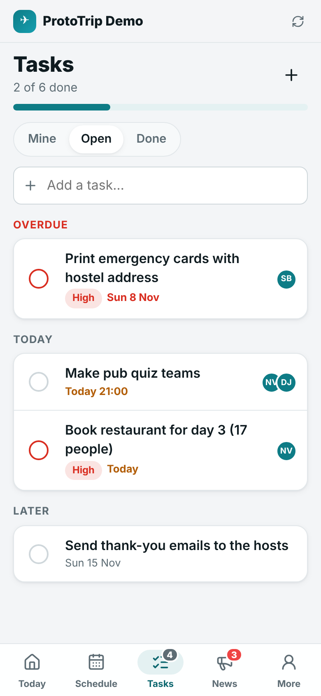
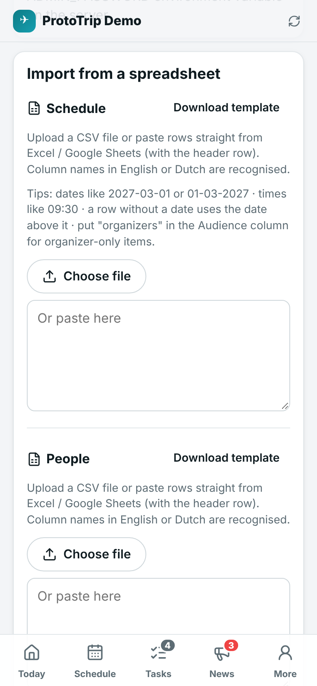
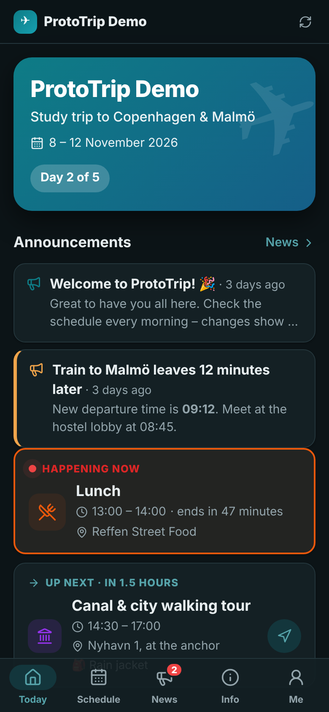

# ProtoTrip ✈️

**The trip app for everyone on ProtoTrip.** Participants see the whole schedule, what's happening *now* and what's *next*. Organizers get their own schedule on top of it – briefings, bookings, private notes and a shared to-do list – that participants never see.

It is a fast, installable web app (PWA): open the link, enter the trip code, and add it to your home screen. It keeps working without internet, sends notifications when plans change, and can put the schedule straight into your phone's calendar.

<p>
  
  
  
  
</p>

> 🇳🇱 **Nederlands?** Zie [Snel aan de slag](#-snel-aan-de-slag-nederlands) onderaan. De app zelf is volledig in het Nederlands én Engels.

---

<p>
  
  
  
  
</p>

## What's in it

### For everyone on the trip
- **Today** – trip countdown or "Day 2 of 5", what's happening **now** (with a progress bar), what's **next** (with countdown, meeting point, what to bring and a map button), and today's programme.
- **Schedule** – day-by-day tabs (swipe between days), search, filters by category and group, a red "now" line, and "Only mine" to see just your own group's programme.
- **Event details** – time, duration, location with *Open in maps*, meeting point, what to bring, cost, links, who's in charge (tap to call), and clear **Cancelled / Tentative / Updated** labels with change notes.
- **News** – announcements from the organizers (info / important / urgent, pinned), with an unread badge.
- **Info** – pages like *Practical info*, *Packing list* (with tick-boxes saved on your phone), *Accommodation* and *Emergency* (tap to call 112 or an organizer).
- **People** – organizers with call / WhatsApp buttons, everyone's groups.
- **Calendar sync** – subscribe in Apple Calendar, Google Calendar or Outlook; changes appear automatically. Optional 15-minute reminders.
- **Push notifications** for news and schedule changes.
- **Works offline** – the last schedule is stored on the phone.
- **English & Nederlands**, light & dark mode, print-friendly schedule.

### For organizers
- A **separate organizer schedule**: any item can be *Everyone* or *Organizers only*. Organizers see both, with a switch between *Everything / Participants / Organizers* to check exactly what participants see.
- **Private organizer notes** on every event (booking references, supplier phone numbers…) – never sent to participants' phones.
- **Tasks**: a shared to-do list with assignees, due dates, priorities, links to events, *Mine / Open / Done* views and progress.
- **Head count** at any event: tap names as people arrive, see who's missing (with a call button) – shared between all organizers' phones (updates every few seconds).
- **Groups** (Group A/B, rooms, buses…) so different people can have different programmes.
- People list with dietary needs, emergency contacts and notes (organizers only) and a dietary overview for restaurants.

### For the trip admin
- Edit everything in the app – or **import the schedule from a spreadsheet** (paste from Excel/Google Sheets or upload a CSV; Dutch and English column names, Dutch date formats and `;`-separated files all work). Same for the people list.
- **Access codes, links and QR codes** to share (with a printable poster), one for participants and one for organizers. "Sign out all devices" if a code leaks.
- Trip settings: name, dates, destination **time zone** (times are always shown in local trip time, even if someone's phone is still on Dutch time), emergency number, accent colour, default language, whether organizers may edit.
- **Backups**: automatic every 6 hours and before every import/reset, one-click restore, full JSON export/import, CSV export.
- *Load the example trip* to try everything out.

---

## Quick start (on your own computer)

You need [Node.js](https://nodejs.org) 20 or newer.

```bash
npm install
```

```bash
npm run build
```

```bash
SEED_DEMO=true npm start
```

Open <http://localhost:3000>. The terminal shows the **participant code**, the **organizer code** and a generated **admin password** – use those to sign in. (Leave out `SEED_DEMO=true` to start with an empty trip.)

For development with hot reload use `npm run dev` and open <http://localhost:5173>.

## Putting it online

Phones need a real HTTPS address to install the app and get notifications, so host it somewhere. Step-by-step guides are in **[docs/DEPLOYMENT.md](docs/DEPLOYMENT.md)**:

| Option | Cost | Notes |
| --- | --- | --- |
| **Render + Neon** | free | Free web service + free PostgreSQL database. Sleeps when unused (first load ~30 s). |
| **Fly.io** | ~free / a few € | Docker + 1 GB volume, fast, Amsterdam region. |
| **Any server with Docker** | your server | `docker compose up -d`, put Caddy/nginx in front for HTTPS. |

## Running the trip

See **[docs/ORGANIZER-GUIDE.md](docs/ORGANIZER-GUIDE.md)** for how to put in the schedule (one by one or from a spreadsheet), keep the organizer programme separate, share the codes and handle changes during the trip.

The short version:

1. Sign in with the admin password → **Manage** → fill in *Trip details* (dates and the destination's time zone matter).
2. Add organizers, participants and groups (**People**, or import a list).
3. Add the schedule. Mark organizer-only items as **Organizers only**; put bookings in **Organizer notes**.
4. Share the **participant code / link / QR code** with the group and the **organizer code** with your fellow organizers.
5. During the trip: edit an event and fill in a *change note*, or post in **News**, and switch on *Send a notification*.

## Configuration

All settings are environment variables (see [.env.example](.env.example)):

| Variable | Default | What it does |
| --- | --- | --- |
| `ADMIN_PASSWORD` | generated | Admin password. If unset, one is generated on first start and printed in the log; it can then be changed in the app. |
| `DATABASE_URL` | – | PostgreSQL connection string. If set, data is stored in that database instead of files. |
| `DATA_DIR` | `./data` | Folder for the data file and backups (when not using PostgreSQL). |
| `PUBLIC_URL` | – | The app's public address (used in calendar feeds and notifications). |
| `PORT` | `3000` | Port to listen on. |
| `SEED_DEMO` | `false` | Load the example trip on the very first start. |
| `VAPID_SUBJECT` | `PUBLIC_URL` | Contact for the push service. |
| `TRUST_PROXY` | `1` | How many proxies sit in front of the app (for correct client IPs). |

Maintenance commands (stop the app first): `npm run reset-admin-password -- <new-password>` and `npm run seed:demo` (replaces the content with the example trip).

## Privacy & security

- Access is by **trip code** (participants), **organizer code** and **admin password**. Codes are case-insensitive and can be changed any time; "Sign out all devices" invalidates every session and calendar link for that role.
- The server only ever sends participants what they may see: no organizer-only items, organizer notes, tasks, codes, or other participants' phone numbers, dietary info or emergency contacts. This is enforced on the server and covered by tests.
- Login attempts are rate-limited. The admin password is stored as a scrypt hash. Content written in the app is rendered without HTML, so it can't inject scripts. Strict security headers (CSP, no framing) are set.
- Choosing "who you are" and checklist ticks stay on the device.

## Development

```
src/
  shared/   types + validation (zod), time-zone maths, calendar (.ics) export, spreadsheet import, visibility rules
  server/   Express API, auth, storage (JSON file or PostgreSQL), push notifications, demo data
  client/   React app: pages, components, i18n (en/nl), offline cache
  sw/       service worker (offline + push)
tests/
  unit/     time zones, CSV import, calendar export, visibility, auth, markdown
  api/      the HTTP API per role (+ PostgreSQL when TEST_DATABASE_URL is set)
  e2e/      full browser walk-through incl. offline mode (needs Playwright)
```

| Command | |
| --- | --- |
| `npm run dev` | API + web app with hot reload |
| `npm run build` / `npm start` | production build / run |
| `npm run typecheck` | TypeScript |
| `npm test` | unit + API tests |
| `npm run test:e2e` | browser test (run `npm run build` first; needs Playwright with Chromium) |

---

## 🇳🇱 Snel aan de slag (Nederlands)

**ProtoTrip** is de app voor de reis: deelnemers zien het hele programma, wat er **nu** gebeurt en wat er **hierna** komt. De organisatie heeft daarbovenop een **eigen programma** (briefings, reserveringen, privénotities) en een gedeelde **takenlijst** – die deelnemers nooit te zien krijgen.

1. Zet de app online (zie [docs/DEPLOYMENT.md](docs/DEPLOYMENT.md) – gratis kan met Render + Neon).
2. Log in met het **beheerderswachtwoord** → **Beheer** → vul de *Reisgegevens* in (data en de tijdzone van de bestemming).
3. Voeg het programma toe: los per activiteit, of **plak het rechtstreeks uit Excel/Google Sheets** (Nederlandse kolomnamen zoals *Datum, Begin, Eind, Activiteit, Locatie, Voor, Groep* worden herkend). Zet bij organisatie-items *Voor* op **organisatie** of kies **Alleen organisatie** in het formulier.
4. Deel de **deelnemerscode / link / QR-code** met de groep en de **organisatiecode** met je mede-organisatoren.
5. Tijdens de reis: wijzig een activiteit met een *wijzigingsnotitie*, of plaats een **Nieuws**-bericht en zet *Stuur een melding* aan.

Meer uitleg: [docs/ORGANIZER-GUIDE.md](docs/ORGANIZER-GUIDE.md).

## License

[MIT](LICENSE)
